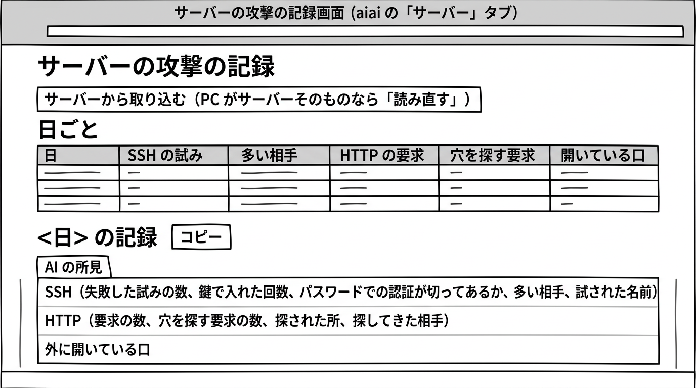

= サーバーの攻撃の記録（kougeki）利用者マニュアル
:toc:
:toc-title: 目次

このマニュアルは、前の日にサーバーが何を受けたかと、手を打つことがあるかを、毎朝読むための手順を説明します。

== はじめの設定

別の場所にあるサーバーの記録を見るときは、アプリを動かす前に、設定（`AIAI_SERVER`）にサーバーの SSH の接続先を書きます。
お使いの PC がサーバーそのものであるときは、この設定は空にします。

== サーバーの攻撃の記録画面（aiai の「サーバー」タブ）

PC で aiai のアプリを開き、「サーバー」のタブを選びます。サインインはありません。

=== 毎朝すること（新しい記録を読む）

. 画面の上にある「サーバーから取り込む」ボタンを押します（お使いの PC がサーバーそのものであるときは、「読み直す」ボタンを押します）。
. 「日ごと」の表がいちばん新しい状態になり、初めはいちばん新しい日の記録が下に開きます。
. 下の「<日> の記録」にある「AI の所見」を読み、前の日と比べていつもと違うことや、手を打つことがあるかを確かめます。

=== 前の日の記録や、別の日の記録を見る

「日ごと」の表には、新しい日が上になるように、毎日の数が並んでいます。
表の列は、左から「日」「SSH の試み」「多い相手」「HTTP の要求」「穴を探す要求」「開いている口」です。

別の日の詳しい中身を読みたいときは、表の「日」の列にある日付を押します。押した日の記録が下に開きます。

=== 1 日の中身の見方

選んだ日の「<日> の記録」には、次の内容が出ます。

* **AI の所見**: いつもと違うことと、手を打つことがあるかが、8 行以内で書いてあります。
* **SSH**: 失敗した試みの数、鍵で入れた回数、パスワードでの認証が切ってあるか（「切ってある」または「切ってない（要注意）」）、多い相手、試された名前が出ます。
* **HTTP**: 要求の数、穴を探す要求の数、探された所、探してきた相手が出ます。
* **外に開いている口**: 外に向けて待ち受けているポートの番号と種類が出ます。

=== ふだんの AI に記録を貼って聞く

その日の記録について、ふだん使っている AI に詳しく聞きたいときは、「<日> の記録」の見出しの近くにある「コピー」ボタンを押します。
その日の記録が写されるので、そのままふだんの AI の画面に貼り付けて聞くことができます。
