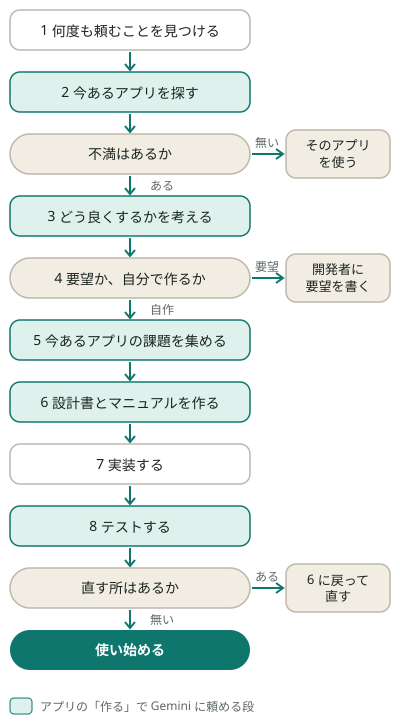

= aiai 利用者マニュアル
:日付: 2026-10-14
:toc:
:toc-title: 目次

https://aiai.aiseed.dev/[aiai] は、ふだん使っている AI に読ませる手引きと、手引きの一部を Google Cloud の Gemini で
試せる aiai のアプリ(https://aiai.aiseed.dev/app/[Web のアプリ]と、スマートフォンのアプリ)です。このマニュアルは、手引きの使い方と、いちばん大事な使い方で
ある「AI に何度も頼んでいることを、アプリにする」流れを、順に説明します。

== 手引きを AI に読ませる

手引きは、AI への決まりを書いたファイル(SKILL.md)で、AI はスキルとして読みます。サイトの手引きのページを開き、
「スキルをコピー」を押して、ふだん使っている AI に貼ります。AI が、あなたに聞きながら進めます。どれを作るか、どう直すかを決めるのは、あなたです。

[cols="1,3"]
|===
| AI | 読ませ方

| Claude | 手引きのページから ZIP を落とし、スキルとして上げます
| Gemini | SKILL.md か ZIP を、スキルとして上げます
| ChatGPT | コピーして貼ります。スキルが使えるワークスペースなら、スキルとして入れます
| Microsoft 365 Copilot | 企業用の場合は、管理者に入れてもらいます
|===

== アプリを作る流れ

色の付いた段は、アプリの「作る」で Gemini に頼めます。

[cols="3,5,3"]
|===
| 段 | すること | どこで

| 1 AI とのチャットの履歴から、何度も頼むことを見つける | 何度も頼んでいることを数え、同じ作業か、同じ直しかを分ける | ふだん使っている AI
| 2 今あるアプリを探す | 似たことをしているアプリの、機能、料金、問題点を知る | ふだん使っている AI か、アプリの「作る」
| 不満はあるか | 無ければ、そのアプリを使う | 自分で決める
| 3 どう良くするかを考える | 不満を具体的にし、どうなればよいかを決める | ふだん使っている AI か、アプリの「作る」
| 4 要望か、自分で作るか | 要望なら、開発者に要望を書く | 自分で決める
| 5 今あるアプリの課題を集める | 問題点を、出典付きの資料にする | ふだん使っている AI か、アプリの「作る」
| 6 設計書とマニュアルを作る | SKILL.md を書き、設計書と利用者マニュアルを作る | ふだん使っている AI(SKILL.md)と、アプリの「作る」
| 7 実装する | 設計書どおりに作る | ふだん使っている AI(コードを書ける物)
| 8 テストする | マニュアルのとおりに使えるか、5 の問題点が起きないかを確かめる | 自分と、ふだん使っている AI。手順はアプリの「作る」でも作れる
| 直す所はあるか | あれば 6 に戻って直す。無ければ使い始める | 自分で決める
|===

ふだん使っている AI には、aiai の手引き「度々聞いていることを、アプリにする」を読ませます。
https://aiai.aiseed.dev/skills/rireki.html[手引きのページ]か、トップページの流れの 1 の段の「スキルをコピー」で
コピーして貼るか、スキルとして入れます。

トップページの「作るまでの流れ」でも、同じ流れが見られます。段を押すと説明が開き、色の付いた段の右の
「Gemini で試す」を押すと、アプリの「作る」のその段の欄に移ります。

== アプリの「作る」を使う前に

=== サインイン

トップページの段の「Gemini で試す」を押すと、サインインしていなければ、サインインの画面が出ます。ID とパスワードを
入れて「サインイン」を押すと、その段が開きます。書いて、「探す」などのボタンを押します。

初めての人は、サインインの画面の「新しく登録する」を押します。ID(3〜32 字の小文字の英数字と `-` `_`)と、
パスワード(8 字以上)を決め、パスワードをもう一度入れて「登録する」を押します。メールアドレスは要りません。

登録しただけでは、Gemini には頼めません。持ち主が承認すると、頼めるようになります。承認される前にボタンを押すと、
「承認されるまで、Gemini には頼めません」と出ます。

サインインは、ページを読み込み直しても、閉じて開き直しても、30 日まで続きます。

サインインすると、上に、名前と「今日あと: N 回」(開いている段で、その日に使える回数)が出ます。終えるときは
「サインアウト」を押します。

=== 知っておくこと

* 対話は、サイトに記録されません。続きを、ふだん使っている AI で進めるときは、要る所をコピーしておきます
* 探す、集める、作るの仕事は、数分かかります。頼んだ欄の下に、進み具合が出ます。ページを閉じても進みます。
  もう一度サインインすると、一覧に出ます
* できた物は 7 日で消えます。残したい物は、「まとめてダウンロード(ZIP)」で保存します
* 渡せる資料は、.md、.adoc、.txt と、それを入れた ZIP です。合わせて 2 MB までです
* できた結果の下には、次の段へ進むボタンが出ます。押すと、次の段の欄で、その結果が選ばれます。「読ませる結果」の
  欄は、選べる結果があるときだけ出ます
* 仕事が止まったら(一覧に「止まりました」)、もう一度頼めます。止まった仕事は、その日の自分の回数に数えません

== 1 AI とのチャットの履歴から、何度も頼むことを見つける

ふだん使っている AI に、手引きを読ませてから、たとえば次のように頼みます。

____
これまでのチャットで、私が何度も頼んでいることを数えてください。
____

AI が、度々頼んでいること、毎回手間がかかっていることを、回数の多い順に並べます。どれをアプリにするかは、
自分で決めます。同じ直し(「余計な説明を書かないで」など)の繰り返しは、アプリにせず、AI への決まりに書きます。

PC の AI の道具(Claude Code など)の記録や、書き出した履歴のファイルは、
https://aiai.aiseed.dev/app/[aiai のアプリ]の「記録」のタブで、AI に渡す材料のファイルにできます。Claude Code は、
既定では 30 日より前の記録を消します。前の記録も使いたいときは、Claude Code の設定 `cleanupPeriodDays` で日数を延ばし
ます。デスクトップアプリと Cowork で始めたか、最後に続けた記録は、既定では消えません
(Claude Code Docs「Data usage」、https://code.claude.com/docs/en/data-usage 、2026-10-14 に確かめました)。

== 2 今あるアプリを探す

. アプリの「作る」の「2 今あるアプリを探す」で、「何度も頼んでいること」に、AI に何度も頼んでいることを書きます
. 「探す」を押します
. 下の一覧に、進み具合が出ます。「できました」になると、調べた結果が、そのまま読める形で出ます

使ってみて、不満が無ければ、そのアプリを使います。不満があれば、次へ進みます。

* 「この結果で、どう良くするかを考える」: 「3 どう良くするかを考える」に移ります
* 「この結果で、課題を集める」: 自分で作ると決めているときは、「5 今あるアプリの課題を集める」に移ります

== 3 どう良くするかを考える

不満は、具体的に書きます。どのアプリの、どの場面で、何が困るのかが分からないと、Gemini も一緒に考えられません。

. アプリの「作る」の「3 どう良くするかを考える」で、「困っていること」を書きます。どのアプリの、どの場面で、何が
  困るのかを書きます。「今あるアプリを探す」の結果があれば、「読ませる結果」で選べます
. 「考える」を押します
. Gemini が聞いてきたことに答えて、「送る」を押します。不満が具体的になるまでは、Gemini は案を出しません
. 初めからやり直すときは、「初めから」を押します

最後に、4 を決めるための材料がまとまります。対話は記録されないので、要る所はコピーしておきます。

== 4 要望か、自分で作るか

自分で決めます。

* 開発者に要望を書くなら、ふだん使っている AI に、3 で分かったことを渡して、要望の文を下書きさせます。流れは
  ここで終わりです
* 自分で作るなら、5 に進みます

== 5 今あるアプリの課題を集める

探したアプリの問題点を集めます。できる資料は、手引きの手順 5 の資料(`references/<名前>-analysis.adoc`)です。

. アプリの「作る」の「5 今あるアプリの課題を集める」で、「読ませる結果」に、「今あるアプリを探す」の結果を選びます
. 「集める」を押します
. 「できました」になると、課題の資料がそのまま出ます。保存するときは「まとめてダウンロード(ZIP)」を押します

資料には、アプリごとに「利用者にとっての問題点」と「運営の作りの問題点」が、読んだページと一緒に並び、最後に
「作るアプリで防ぐこと」があります。次へ進むときは、「この資料で、設計書とマニュアルを作る」を押します。

== 6 設計書とマニュアルを作る

まず、作るアプリの決まり事を、SKILL.md に書きます。手引きの「アプリの SKILL.md の形」に沿って、ふだん使って
いる AI と書きます。誰に使ってもらうか、無料か、どこで動かすか、サインインをどうするかは、自分で決めます。

次に、設計書と利用者マニュアルを作ります。

. アプリの「作る」の「6 設計書とマニュアルを作る」で、5 の資料を読ませるなら、「読ませる課題の資料」で選びます
. 「資料を選ぶ」で、SKILL.md と参考の資料(または、それを入れた ZIP)を選びます
. 「作る」を押します
. 10 分ほどかかります。「できました」になると、利用者マニュアルと画面の絵が出ます。設計書と照らし合わせの記録は、題を押すと開きます。「まとめてダウンロード
  (ZIP)」で保存します

ZIP には、設計書(`docs/design.adoc`)、利用者マニュアル(`docs/manual.adoc`)、画面の絵、2 つを照らし合わせた
記録(`docs/kakunin.adoc`)が入っています。マニュアルを読んで、使う人がすることが、思ったとおりかを確かめます。
違っていたら、SKILL.md を直して、もう一度作ります。

== 7 実装する

コードを書ける、ふだん使っている AI(Claude Code、Codex、Gemini CLI など)に、SKILL.md、設計書、利用者マニュアル
を読ませて、たとえば次のように頼みます。

____
SKILL.md と設計書のとおりに、このアプリを作ってください。
____

何を作るかは、SKILL.md と設計書で決まっています。AI には、コーディングを任せます。作っている間に、設計書や
利用者マニュアルを直してもかまいません。直したら、AI にもう一度読ませます。

== 8 テストする

. アプリの「作る」の「8 テストの手順を作る」で、「読ませる設計書とマニュアル」に、6 の結果を選びます。ほかで作った
  設計書や利用者マニュアルは、「資料を選ぶ」で選びます
. 「作る」を押します
. 「できました」になると、テストの手順がそのまま出ます。保存するときは「まとめてダウンロード(ZIP)」を押します
. 手順のとおりに、作ったアプリを自分で使い、「確かめ」の欄に結果を書きます
. ふだん使っている AI に、テストの手順の「試験に書くこと」を読ませ、試験を書かせて動かします

テストの手順には、マニュアルの操作ごとに、することと、そうなるはずのことが並び、5 の問題点ごとに、起きない
ことの確かめ方が書いてあります。

== 直す所はあるか

* 直す所があれば、6 に戻ります。まず SKILL.md を直し、設計書と利用者マニュアルを直してから、アプリを直し、
  もう一度テストします
* 直す所が無ければ、使い始めます。使う人には、利用者マニュアルを見せます

使い始めてからも、利用者マニュアルを見ながら、直したい所を AI に話してかまいません。

== ほかの手引き

[cols="2,3"]
|===
| 手引き | 使うとき

| https://aiai.aiseed.dev/skills/website.html[Web サイトを作る] | 自分で作ると決めたとき。公開してよい事実だけで、静的なページを作る
| https://aiai.aiseed.dev/skills/moushikomi.html[申し込みを受ける] | Apple ID か Google ID でサインインした人から、取り置きや予約を受ける
| https://aiai.aiseed.dev/skills/genba.html[現場で VLM を使う] | 畑、店、空き家、民泊の写真や映像を AI に読ませ、判断を助ける
| https://aiai.aiseed.dev/skills/kaiseki.html[読まれ方の記録で、サイトを直す] | 読む人がどこで読み、何を探しているかを、Cookie を置かずに記録し、ページを直す
| https://aiai.aiseed.dev/skills/kanri.html[自分のシステムを、自分で管理する] | 毎日のログを数えて AI に読ませ、自分のサーバーを守る
| https://aiai.aiseed.dev/skills/news.html[自分の分野のニュースを作る] | 分野、地域、件数、扱わない物を決めて、毎朝の下書きを作らせる
| https://aiai.aiseed.dev/skills/tenshoku.html[転職を考える] ・ https://aiai.aiseed.dev/skills/gakusei.html[AI の時代、何を学ぶか] ・ https://aiai.aiseed.dev/skills/keikaku.html[自然農法の経営計画] | 必要なときに
|===

[[tools]]
== 一緒に使う物

* https://aiai.aiseed.dev/shoukai/aiai-tools.html[aiai tools]: 会社や団体の仕事も受けるとき、会社の IT を OSS と AI で自分の側に
  置くためのスキル
* https://aiai.aiseed.dev/shoukai/officework.html[officework]: Office の書類を、Microsoft Office なしで読み書きする、文書と
  表計算の OSS。書類は adoc で持つ
* https://aiai.aiseed.dev/shoukai/weather.html[個人開発気象統計]: 気象庁のデータから、全国の地点の気温の順位や雨温図を出す、個人のサイト。AI と一緒に作った実例

== 知らせが出たとき

[cols="3,2"]
|===
| 知らせ | すること

| 今日の分(N 回)は使い終わりました。明日またどうぞ | 明日、使います
| 今日の受け付けは終わりました。明日またどうぞ | 明日、使います
| 何度も頼んでいることを書いてください | 書いてから「探す」を押します
| 困った場面と、困ったことを書いてください | 書いてから「考える」を押します
| 読ませる結果を選んでください | 先に 2 の「探す」を動かし、その結果を選びます
| SKILL.md と参考の資料を選んでください | 「資料を選ぶ」で SKILL.md を入れた資料を選びます
| 読ませる設計書とマニュアルを選ぶか、資料を選んでください | 「読ませる設計書とマニュアル」を選ぶか、資料を選びます
| 読ませられるのは、できあがった「…」の結果です(または資料です) | 一覧で「できました」になってから選びます
| 資料が入っていません(.md、.adoc、.txt か、それを入れた ZIP) | 渡せる形の資料を選びます
| 資料が大きすぎます(2 MB まで) | 資料を減らします
| 対話が長くなりました。続きは、ふだん使っている AI で進めてください | 要る所をコピーし、ふだんの AI で続けます
| ID かパスワードが違います | 書き直します
| 今日は、この ID では入れません | 明日、入ります
| この ID は使われています | 別の ID を決めます
| 2 つのパスワードが同じではありません | もう一度入れ直します
| 承認されるまで、Gemini には頼めません | 持ち主の承認を待ちます
| 一覧に「止まりました」と出た | もう一度頼みます。止まった仕事は、自分の回数に数えません
|===
